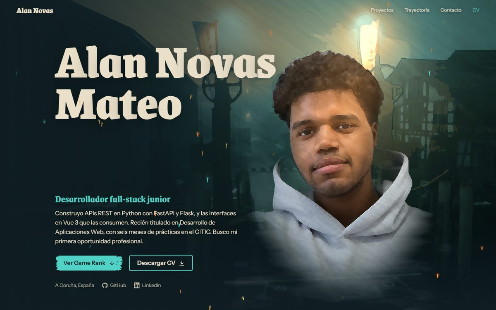
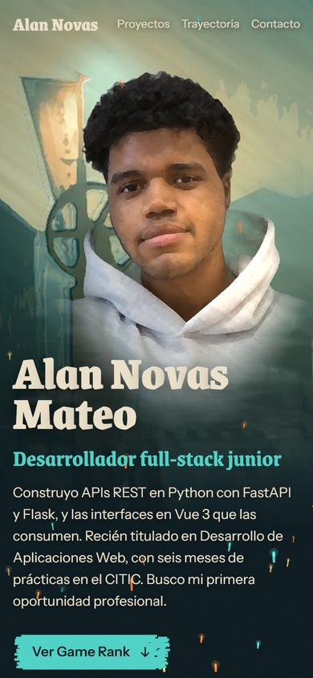
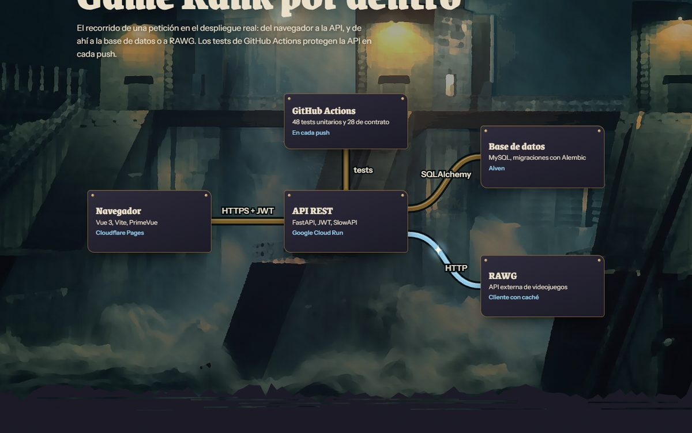

# Portafolio de Alan Novas Mateo

[](https://github.com/Alan3420/portafolio/actions/workflows/ci.yml)

Web personal de portafolio de un desarrollador full-stack junior (Python + Vue 3). Presenta el proyecto principal, [Game Rank](https://github.com/Alan3420/Game-Rank), con su arquitectura de despliegue, dos proyectos secundarios, la trayectoria, el stack y el contacto.

La estética es de ilustración pintada: fotografías convertidas en "óleo" con profundidad 2.5D que reaccionan al cursor y al scroll, con efectos 2D (chispas, pulsos, entradas por fotogramas) dibujados a 30 fps sobre una escena que se mueve a la frecuencia de la pantalla.

| Escritorio                                                                                                                                       | Móvil                                                                                                           |
| ------------------------------------------------------------------------------------------------------------------------------------------------ | --------------------------------------------------------------------------------------------------------------- |
|  |  |

| Arquitectura de Game Rank                                                                                                  | Contacto                                                                                                              |
| -------------------------------------------------------------------------------------------------------------------------- | --------------------------------------------------------------------------------------------------------------------- |
|  |  |

## Tecnologías

| Parte                   | Tecnología                                                                                       |
| ----------------------- | ------------------------------------------------------------------------------------------------ |
| Framework               | Vue 3 (`<script setup>`) + Vite                                                                  |
| Animación               | GSAP (ScrollTrigger, SplitText) y Lenis para el scroll suave                                     |
| Gráficos                | WebGL2 propio (sin librerías) y Canvas 2D                                                        |
| Calidad                 | ESLint (reglas recomendadas de Vue), Prettier, Vitest y GitHub Actions                           |
| Preparación de imágenes | Python: Kuwahara generalizado en GPU (PyTorch) y Depth Anything V2 para los mapas de profundidad |

## Arquitectura

El código sigue una separación por capas al estilo MVC. Vue es un framework de componentes, así que la correspondencia es esta:

| Capa          | Carpeta            | Responsabilidad                                                                                                                                                             |
| ------------- | ------------------ | --------------------------------------------------------------------------------------------------------------------------------------------------------------------------- |
| Modelo        | `src/models/`      | Datos y lógica pura, sin DOM ni efectos: contenido, arquitectura del diagrama, física de partículas, encuadre de imágenes, máscaras de pincel. Todo lo testeable vive aquí. |
| Vista         | `src/views/`       | Componentes `.vue` que solo pintan (`secciones/`, `componentes/`), estilos y los renderizadores WebGL y Canvas (`graficos/`).                                               |
| Controlador   | `src/controllers/` | Composables que gestionan efectos y ciclo de vida: GSAP, Lenis, escenas, listeners y temporizadores, siempre con su limpieza al desmontar.                                  |
| Configuración | `src/config.js`    | Todos los parámetros ajustables. Los componentes no llevan números mágicos.                                                                                                 |

```
src/
  config.js                   Parámetros: fps, escenas, paletas, chispas, tiempos
  main.js                     Punto de entrada y fuentes locales
  models/
    perfil.js                 Contenido: persona, proyectos, trayectoria, stack
    arquitectura.js           Nodos, disposiciones y recorrido del diagrama de Game Rank
    particulas.js             Física de las chispas (px/s, independiente de los fps)
    encuadre.js               Recorte tipo "cover" de imágenes
    pincel.js                 Máscaras SVG de pincelada con semilla fija
    animacion.js              Ease por fotogramas a la cadencia configurada
  views/
    App.vue                   Composición de la página
    secciones/                Hero, Game Rank, arquitectura, otros proyectos, trayectoria, stack, contacto
    componentes/              Navegación, pie, iconos, lienzo pintado
    graficos/                 Renderizador WebGL2, shaders y renderizador de chispas
    estilos/base.css          Tokens de diseño y estilos base
  controllers/
    movimiento.js             Registro de GSAP, scroll suave y paleta por scroll
    usarHero.js               Escenas del hero, chispas y entrada orquestada
    usarLienzoPintado.js      Fondos pintados con carga diferida
    usarDiagrama.js           Pulso por las tuberías y disposición según el ancho
    ...                       Navegación, copiar correo, animaciones de sección
tests/                        Tests de los modelos (Vitest)
scripts/
  pintar.py                   Convierte una foto en "pintura" y aplica la gradación de color
  profundidad.py              Genera el mapa de profundidad de una imagen
```

## Scripts

```bash
npm install
npm run dev            # servidor de desarrollo
npm run lint           # ESLint
npm run format         # Prettier (escribe)
npm run format:check   # Prettier (solo comprueba)
npm test               # Vitest
npm run build          # compila en dist/
npm run check          # lint + formato + tests + build, igual que la CI
```

## Tests

33 tests sobre los modelos:

- Las máscaras de pincel son deterministas y no generan valores inválidos.
- La física de las chispas da el mismo recorrido a 12 y a 30 fps, y respeta los rangos de `config.js`.
- El diagrama es coherente: cada nodo tiene caja en las dos disposiciones, los tubos unen nodos existentes y el pulso recorre los tramos en el orden y sentido correctos.
- El encuadre "cover" recorta y ancla bien.
- El contenido es válido: enlaces https, correo con formato correcto, y el CV y las capturas existen.

## Rendimiento y accesibilidad

Lighthouse 12 sobre la compilación de producción:

| Perfil                             | Rendimiento | Accesibilidad | Buenas prácticas | SEO |
| ---------------------------------- | ----------- | ------------- | ---------------- | --- |
| Escritorio                         | 99          | 100           | 100              | 100 |
| Móvil (CPU ×4, red lenta simulada) | 83          | 100           | 100              | 100 |

- El efecto de pintura se calcula antes de publicar, no en el navegador del visitante.
- Las escenas WebGL solo se dibujan mientras están visibles, y los fondos inferiores se crean al acercarse a ellos.
- Con `prefers-reduced-motion` no hay scroll suave, ni chispas, ni animaciones: las escenas se pintan una vez en estático.
- Sin WebGL2, los fondos y el retrato se muestran como imágenes normales.
- Las fuentes se sirven desde el propio sitio: no hay peticiones a Google Fonts.

## Regenerar las imágenes pintadas

Las imágenes de `src/assets/img/` ya están generadas. Para rehacerlas hace falta Python con `torch`, `transformers`, `numpy` y `Pillow`. Las fotos originales van en `raw/`, que no se versiona:

```bash
python scripts/profundidad.py raw/ciudad-baja.jpg raw/ciudad-baja-depth.png
python scripts/pintar.py raw/ciudad-baja.jpg raw/ciudad-baja-pintada.jpg --radios 8,5 --ancho 2400 --grade under --depth raw/ciudad-baja-depth.png
```

`--grade under` aplica la paleta de la ciudad baja (azul verdoso y ámbar) y `--grade upper` la de la ciudad alta (latón y ciruela).

## Despliegue

Cualquier hosting estático. En Cloudflare Pages:

- Comando de compilación: `npm run build`
- Directorio de salida: `dist`

## Créditos de imágenes

Fotografías de dominio público (CC0) procesadas por código:

- "Romanshorn At Dusk", Raphael Roth: https://commons.wikimedia.org/wiki/File:Romanshorn_At_Dusk_(Unsplash).jpg
- "Stormy Night At The Dam", Jani Brumat: https://commons.wikimedia.org/wiki/File:Stormy_Night_At_The_Dam_(Unsplash).jpg
- "Bridge Nightfall City Skyline", Will Langenberg: https://commons.wikimedia.org/wiki/File:Bridge_Nightfall_City_Skyline_(Unsplash).jpg

Tipografías con licencia OFL, servidas mediante Fontsource: Grenze, Instrument Sans y Permanent Marker.
